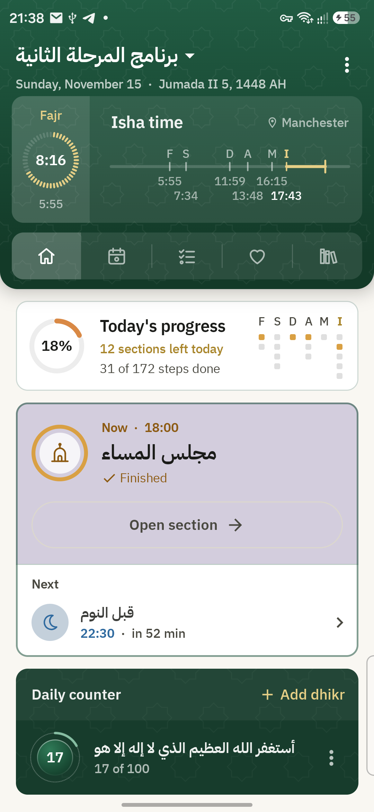
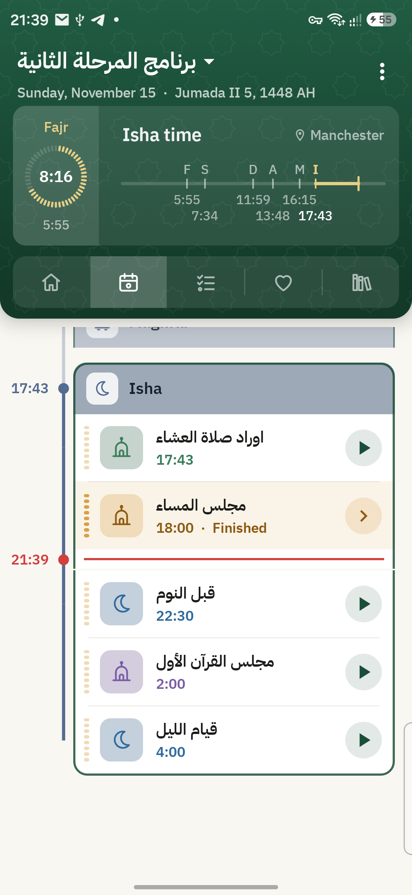
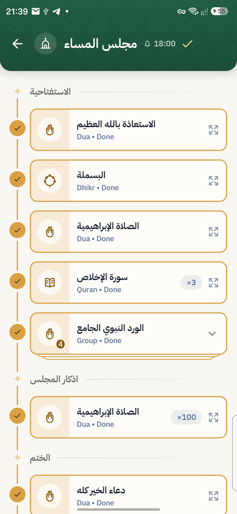
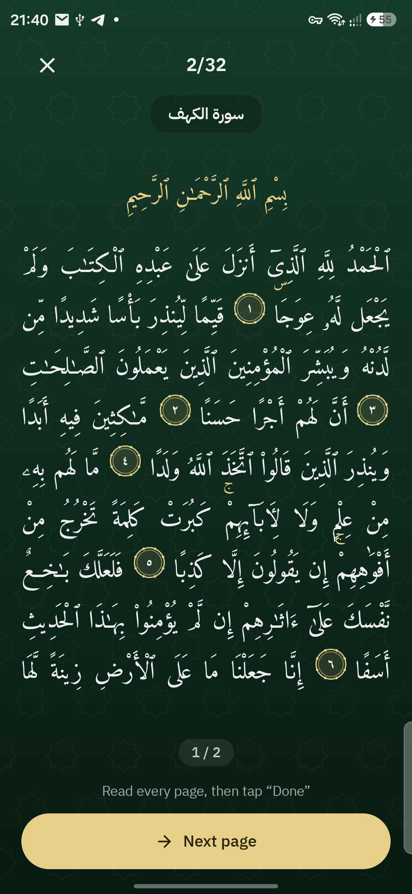
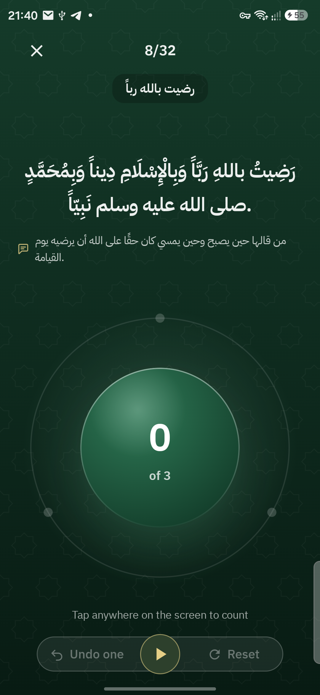
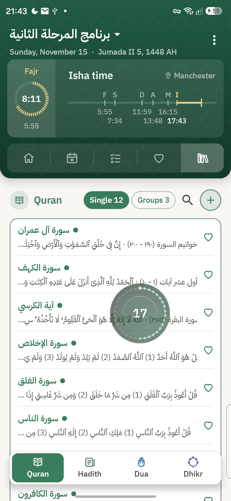
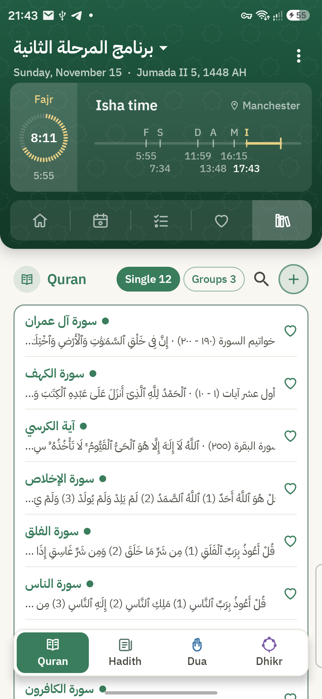
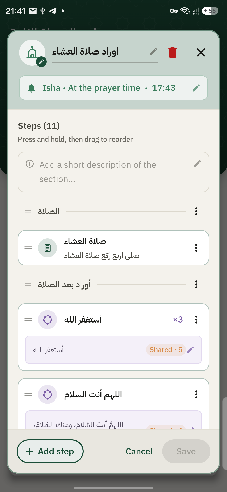
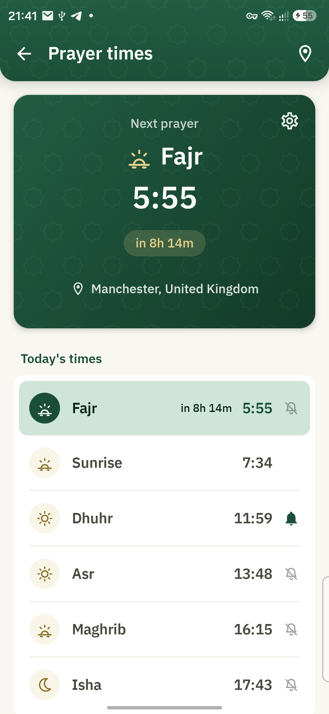

<p align="center">
  
</p>

<h1 align="center">Dhikra · ذكرى</h1>

<p align="center">
  A daily program of dhikr, Quran and du'a, organised around the prayer times.<br>
  <span dir="rtl">برنامجك اليومي من الأذكار والقرآن والدعاء، مرتّبًا حول مواقيت الصلاة.</span>
</p>

<p align="center">
  Android 7.0+ · Arabic &amp; English · Works fully offline · No ads, no tracking
</p>

---

## Screenshots

<table>
  <tr>
    <td></td>
    <td></td>
    <td></td>
  </tr>
  <tr>
    <td align="center">Home</td>
    <td align="center">Today's timeline</td>
    <td align="center">A section's steps</td>
  </tr>
  <tr>
    <td></td>
    <td></td>
    <td></td>
  </tr>
  <tr>
    <td align="center">Quran reader</td>
    <td align="center">Tap anywhere to count</td>
    <td align="center">Floating counter</td>
  </tr>
  <tr>
    <td></td>
    <td></td>
    <td></td>
  </tr>
  <tr>
    <td align="center">Library</td>
    <td align="center">Section editor</td>
    <td align="center">Prayer times</td>
  </tr>
</table>

All screens: [English overview](docs/screenshots/en/overview.png) · [Arabic overview](docs/screenshots/ar/overview.png)
· individual shots in [`docs/screenshots/en`](docs/screenshots/en) and [`docs/screenshots/ar`](docs/screenshots/ar).

## Features

- **A daily program** – sections such as morning adhkar, after-prayer awrad or night prayer, each tied to a
  prayer time or a fixed time, with today's progress and a timeline of what's next.
- **Step reader** – read each step full screen: Quran in page layout, du'a and dhikr with their notes, and a
  tap-anywhere counter with undo and reset.
- **Floating counter** – keep a counter on top of other apps; drag it, tap to count, and let it fade when idle.
- **Library** – Quran, hadith, du'a and dhikr as single texts or groups, with search and favourites.
- **Editor** – build sections from steps, group steps, reorder by dragging, set repetitions, and share one text
  between several sections.
- **Prayer times** – calculated on the device for the city you pick from a built-in list of cities worldwide,
  with each country's usual method and Asr school, adjustable per prayer.
- **Reminders** – a reminder for each section at its prayer or time, with your choice of sound.
- **Widgets** – the next prayer and the Hijri month on your home screen.
- **Several programs** – switch between programs, and share, export or import them as `.dhikra.json` files.
- **Arabic and English** – full right-to-left layout in Arabic.

## Privacy

Dhikra has no internet permission, no location permission, no ads, no analytics and no accounts. Everything you
create stays on your device. See the [privacy policy](docs/privacy-policy.html).

## Building

Open the project in Android Studio, or build from the command line:

```sh
./gradlew assembleDebug        # debug build: io.github.arcm111.dhikra.debug
./gradlew test                 # unit tests
```

The bundled databases in `app/src/main/assets` are generated by the scripts in [`scripts/`](scripts):
`build-quran-db.sh` (Quran text) and `build-cities-db.py` (cities for the prayer times).

## License

Dhikra is free software: you can redistribute it and/or modify it under the terms of the
[GNU General Public License v3.0](LICENSE). If you publish a modified version, you must release its source
code under the same license.

### Name and icon

The name **"Dhikra" / "ذكرى"** and the **Dhikra icon and logo** are not covered by the GPL and are not licensed
for use in other apps. You are welcome to fork and change the code, but please publish your version under a
different name and with a different icon, so that people aren't misled into thinking it is the original app.

### Third-party data and libraries

| Component | Source | License |
|---|---|---|
| Quran text (Uthmani) | [Tanzil Project](https://tanzil.net) | [CC BY 3.0](https://creativecommons.org/licenses/by/3.0/), used verbatim |
| Cities, coordinates and time zones | [GeoNames](https://www.geonames.org) | [CC BY 4.0](https://creativecommons.org/licenses/by/4.0/) |
| Morning and evening adhkar | [Seen-Arabic/Morning-And-Evening-Adhkar-DB](https://github.com/Seen-Arabic/Morning-And-Evening-Adhkar-DB) | [MIT](scripts/starter/adhkar-db/LICENSE) |
| Azan recording ("Beautiful adhan") | [Wikimedia Commons](https://commons.wikimedia.org/wiki/File:Beautiful_adhan.ogg) | Public domain (CC0) |
| Prayer time calculation | [Adhan](https://github.com/batoulapps/adhan-kotlin) by Batoul Apps | MIT |
| Android Jetpack and Compose | Google / AOSP | Apache 2.0 |

These components keep their own licenses. The Tanzil text is distributed unchanged, as its terms require.
